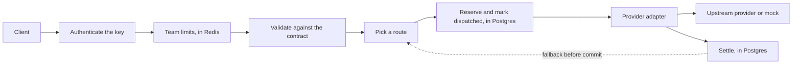

# llmgate

An OpenAI-compatible gateway for LLM providers, built around three hard problems:

1. Budget accounting that stays correct under concurrency, retries, failures, and restarts.
2. Streaming with a precise rule for when failover is still allowed.
3. Low overhead, measured reproducibly rather than asserted.

The aim is depth on those problems, not a long list of providers.

**Status: early development, not ready for production.** Streaming and non-streaming proxying, both provider adapters, fallback, circuit breakers, tenant keys, team limits, and budgets work against a local mock with real Postgres and Redis. Nothing has run against a live provider. See [What works today](#what-works-today).

## Quick start

You need Go 1.27.3 or later, `curl`, `python3`, and `lsof`. The demo uses a local mock provider, so it needs no credentials and costs nothing.

```bash
make demo
```

It starts the mock and the gateway on `127.0.0.1:18301` and `127.0.0.1:18300`, then shows:

- Streaming and non-streaming requests through the gateway.
- An unsupported field rejected by name.
- A provider failing before any content, with the request falling back to another route.
- Every route failing before any content, which is an ordinary HTTP error.
- A provider failing after content, which is one error event and no `[DONE]`.
- A client disconnect canceling the upstream request.
- What the gateway recorded for each attempt.

If those ports are in use, set `LLMGATE_DEMO_GATEWAY_PORT` and `LLMGATE_DEMO_MOCK_PORT`.

That demo runs development mode, which has one shared key and enforces no budget. For teams, keys, and budgets, see [Running tenant mode](docs/admin.md).

To run the pieces yourself:

```bash
go run ./cmd/llmgate-mock &
LLMGATE_DEV_KEY=dev LLMGATE_MOCK_PROVIDER_KEY=mock \
  go run ./cmd/llmgate serve --config configs/demo.yaml &

curl http://127.0.0.1:18300/v1/chat/completions \
  -H 'Authorization: Bearer dev' \
  -d '{"model":"demo-fast","stream":true,"messages":[{"role":"user","content":"hello"}]}'
```

## How it works



Four decisions shape the design:

- **A request either fits the declared contract or is rejected by name.** Nothing is silently dropped. See [compatibility.md](docs/compatibility.md) and [ADR 0001](docs/adr/0001-reject-what-the-contract-cannot-honor.md).
- **Failover stops at a precise commitment point.** Once response headers or stream bytes have gone out, no other provider can serve that response. Headers wait for the first event with real content, so a provider that sends a prelude and then dies can still fall back. See [ADR 0003](docs/adr/0003-downstream-commitment-point.md).
- **What happens next depends on what went wrong.** An invalid request isn't retried and a client's behavior never affects a provider's health. See [ADR 0004](docs/adr/0004-routing-and-failure-handling.md).
- **Postgres alone decides spending.** Each attempt reserves the most it could cost, in a transaction that locks the team's budget, and commits its intent to send before anything is sent. A crash at any point resolves conservatively, and absent usage is never treated as free. Redis only holds rate limits, and an outage there can't bypass a budget. See [ADR 0002](docs/adr/0002-postgres-is-the-budget-authority.md).

## What works today

| Area | Status |
|---|---|
| Request validation against the declared contract | Implemented |
| OpenAI-compatible and Anthropic adapters, streaming and non-streaming | Implemented, tested against the local mock only |
| Capability filtering, weights, fallback, circuit breakers, concurrency limits, and fair admission | Implemented. Breakers and concurrency limits are per process. |
| Commitment boundary, deadlines, cancellation, slow clients | Implemented |
| Deterministic mock provider, both wire formats | Implemented |
| Tenant keys, revocation, team rate and in-flight limits across replicas | Implemented in tenant mode |
| Budgets, durable per-attempt ledger, reconciliation after crashes | Implemented in tenant mode. Tested under 1,200 concurrent requests across four replicas, a killed process, and a crash inside settlement. |
| Admin API and operator CLI: teams, keys, budgets, usage | Implemented. See [docs/admin.md](docs/admin.md). |
| Development mode: one shared key, no budgets, loopback only | Implemented, and every response says `X-Llmgate-Budget-Enforcement: none` |
| Response cache, metrics, traces, dashboards | Not built (M4) |
| Helm chart, load tests, overhead measurements | Not built (M5) |

No test in this repository has run against a live provider. No overhead numbers are published yet, because none have been measured under controlled conditions.

## Limitations

- **Budgets bound reservations, not provider behavior.** A reservation covers the most an attempt could cost under the configured prices. A provider that ignores the output limit, or a tokenizer producing more tokens than the input bound allows, can cost more. That charge is still applied, flagged, and logged. See [ADR 0002](docs/adr/0002-postgres-is-the-budget-authority.md).
- **Prices are configuration.** The example prices are made up. Copy real ones from each provider's pricing page into a new price list version.
- **Breakers and provider concurrency limits are per replica.** Budgets and team limits hold across replicas.
- **Development mode controls nothing.** It's loopback only, and says so on every response and at startup.
- **Text chat only.** Tools, images, audio, and structured output are rejected.

## Development

```bash
make test    # Tests with the race detector
make check   # Build, vet, tests, lint, vulnerability scan, and secret scan
```

`make check` needs [golangci-lint](https://golangci-lint.run/), [govulncheck](https://pkg.go.dev/golang.org/x/vuln/cmd/govulncheck), and [gitleaks](https://github.com/gitleaks/gitleaks).

## License

Proposed: [Apache-2.0](LICENSE).
