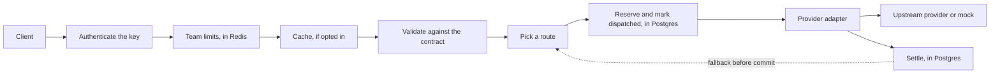

# llmgate

An OpenAI-compatible gateway for LLM providers, built around three hard problems:

1. Budget accounting that stays correct under concurrency, retries, failures, and restarts.
2. Streaming with a precise rule for when failover is still allowed.
3. Low overhead, measured reproducibly rather than asserted.

The aim is depth on those problems, not a long list of providers.

**Status: a release candidate, not yet used in production.** Everything below runs and is tested against a local mock provider, with real Postgres and Redis. Nothing has run against a live provider.

## Ten-minute demo

You need Go 1.27.3 or later, Docker with Compose, `curl`, and `lsof`. Every provider in the demo is a local mock, so it needs no credentials and costs nothing.

```bash
make demo
```

It starts Postgres and Redis, then the mock and the gateway in tenant mode, on a fresh database, and shows:

- Two teams, each with its own API key and monthly budget.
- A streamed response.
- A provider failing before any content, and the request served by the next route, with both attempts accounted for.
- One team sending requests until its budget can't cover another, and getting `429 budget_exhausted`, while the other team carries on.
- Each team's spending, attempt by attempt, from the ledger, and the same story in the gateway's metrics.

`make demo-dev` shows development mode instead: one shared key, no budgets, and how the commitment point behaves when providers fail before and after content.

## How it works



Four decisions shape the design:

- **A request either fits the declared contract or is rejected by name.** Nothing is silently dropped. See [compatibility.md](docs/compatibility.md) and [ADR 0001](docs/adr/0001-reject-what-the-contract-cannot-honor.md).
- **Failover stops at a precise commitment point.** Once response headers or stream bytes have gone out, no other provider can serve that response. Headers wait for the first event with real content, so a provider that sends a prelude and then dies can still fall back. See [ADR 0003](docs/adr/0003-downstream-commitment-point.md).
- **What happens next depends on what went wrong.** An invalid request isn't retried, and a client's behavior never affects a provider's health. See [ADR 0004](docs/adr/0004-routing-and-failure-handling.md).
- **Postgres alone decides spending.** Each attempt reserves the most it could cost, atomically against the team's budget, and commits its intent to send before anything is sent. A crash at any point resolves conservatively, and absent usage is never treated as free. Redis only holds rate limits and cached answers, and an outage there can't bypass a budget. See [ADR 0002](docs/adr/0002-postgres-is-the-budget-authority.md).

## What's here

| Area | Notes |
|---|---|
| OpenAI-compatible `/v1/chat/completions`, streaming and non-streaming | A declared text-chat subset. Anything else is rejected by name. |
| OpenAI-compatible and Anthropic adapters | Tested against protocol fixtures and the mock, never a live provider |
| Routing | Aliases, tiers, weights, capability filtering, fallback before commit, circuit breakers, provider concurrency limits with fair queueing between teams |
| Tenancy | Virtual keys shown once and stored hashed, revocation within a bounded delay, team rate and in-flight limits shared across replicas |
| Budgets and accounting | Per-attempt reservations, a durable ledger, idempotent settlement, reconciliation after crashes, late usage corrections |
| Response cache | Team-scoped and opt-in, with hits that cost nothing |
| Operations | Admin API and CLI, Prometheus metrics, OpenTelemetry traces, a Grafana dashboard, runbooks |
| Deployment | A 53 MB non-root image, a Compose stack, a Helm chart tested on kind |
| Measurement | A load harness and a script that compares the mock directly with the gateway |

## What's proven, and how

The tests run against the real gateway, real Postgres, and real Redis, over real sockets. Highlights:

- **Budgets hold under concurrency.** 1,200 simultaneous requests across four replicas never break `settled + reserved <= limit` in any committed state, every served request is charged exactly once, and nothing reaches the provider without a reservation.
- **Crashes resolve conservatively.** A gateway process killed with `SIGKILL` mid-stream leaves its liability held until a reconciler charges the most it could have cost. A settlement killed partway leaves nothing half done.
- **Failover respects the commitment point.** A failure before commit falls back. After commit, no other provider is ever called, which the mock's request counts prove.
- **Outages fail closed, quickly.** An unreachable or hung Postgres refuses admission within seconds. A hung Redis fails team limits closed in well under a second, and never affects budgets.
- **Deployments don't drop requests.** On kind, 12,271 requests went through a rolling restart without a failure, and every attempt reconciled exactly.

Before each milestone, the code was deliberately broken in dozens of ways to check that a test fails for each break, and an independent review looked for bugs the tests missed. Both found real bugs, which are fixed.

## Performance

`scripts/bench.sh` runs the same workload against the mock directly, through development mode, and through tenant mode, and also measures failover, memory per stream, fairness between teams, and how closely reservations match charges. See [docs/performance.md](docs/performance.md) for the method.

No numbers are published yet. The runs so far were on a machine shared with other work, and a contended run isn't a clean measurement.

## Documentation

- [Running tenant mode](docs/admin.md): setup, the CLI, the admin API, the cache, and operational requirements
- [Deployment](docs/deployment.md): the image, Compose, Helm, and the kind test
- [Observability](docs/observability.md): metrics, traces, the dashboard, and profiling
- [Runbooks](docs/runbooks.md): what to do when things fail
- [Compatibility](docs/compatibility.md): the supported request subset, errors, and headers
- [Performance](docs/performance.md): how overhead is measured
- Architecture decisions: [ADR 0001](docs/adr/0001-reject-what-the-contract-cannot-honor.md), [0002](docs/adr/0002-postgres-is-the-budget-authority.md), [0003](docs/adr/0003-downstream-commitment-point.md), [0004](docs/adr/0004-routing-and-failure-handling.md)

## Limitations

- **Budgets bound reservations, not provider behavior.** A reservation covers the most an attempt could cost under the configured prices. A provider that ignores the output limit, or a tokenizer producing more tokens than the input bound allows, can cost more. That charge is still applied, flagged, and logged.
- **One team's admission rate is bounded by Postgres latency.** Strict budgets serialize a team's reservations on its budget row.
- **Prices are configuration.** The example prices are made up. Copy real ones from each provider's pricing page into a new price list version.
- **Breakers and provider concurrency limits are per replica.** Budgets and team limits hold across replicas.
- **Development mode controls nothing.** It's loopback only, and says so on every response and at startup.
- **Text chat only.** Tools, images, audio, and structured output are rejected.

## Development

```bash
make test               # Unit tests with the race detector
make test-integration   # Everything, with real Postgres and Redis from Compose
make check              # Build, vet, tests, lint, vulnerability scan, and secret scan
./scripts/kind-test.sh  # The Helm chart on a local kind cluster
```

`make check` needs [golangci-lint](https://golangci-lint.run/), [govulncheck](https://pkg.go.dev/golang.org/x/vuln/cmd/govulncheck), and [gitleaks](https://github.com/gitleaks/gitleaks).

## License

Proposed: [Apache-2.0](LICENSE).
