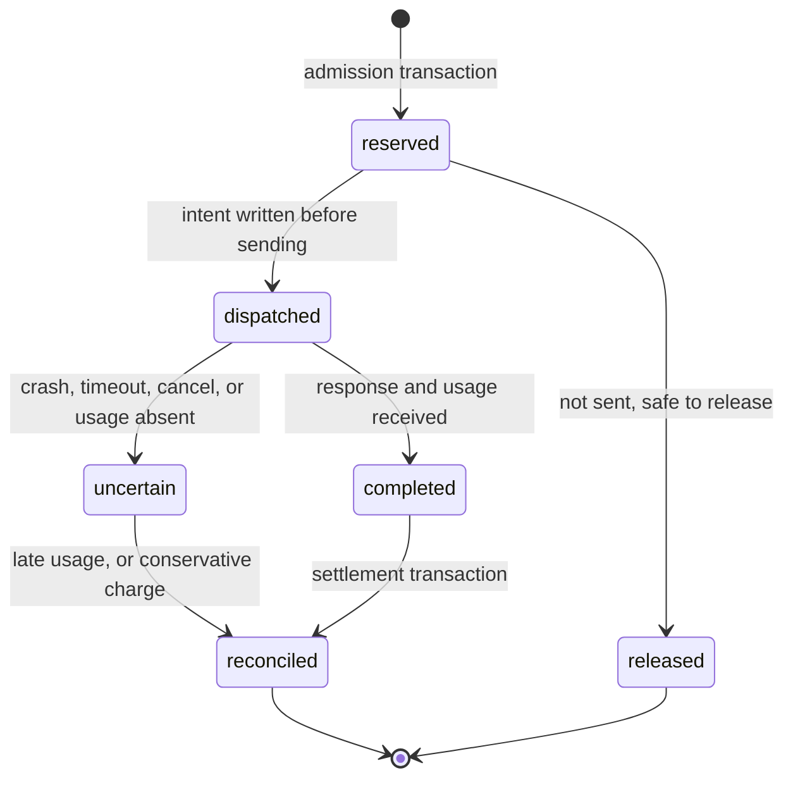

# ADR 0002: Postgres is the budget authority

**Status:** Accepted and implemented, 2026-11-05. Tenant mode enforces it. Development mode enforces no budget and says so: see [Development mode](#development-mode).

## Context

The tempting design keeps a fast counter in Redis and writes usage to Postgres afterward. That creates two authorities that disagree whenever Redis loses writes, fails over, or restarts. Money would then depend on a store chosen for speed.

A reservation also has to survive more than concurrency:

- A failed attempt can still cost money, and a fallback adds another charge.
- A provider may have started billing when the gateway crashes.
- A worker's lease expiring proves nothing about what the provider did.
- Usage can arrive late, twice, or not at all.

## Decision

**Postgres is the sole authority for money and outstanding budget liability.** Redis may hold rate-limit counters, cached responses, and derived values that can be rebuilt from Postgres. It never decides whether a request may spend.

### Invariant

In strict mode, for each budget period, at every committed transaction, within the documented pricing model:

```text
settled_spend + outstanding_reserved + new_reservation <= budget_limit
```

Admission and each additional attempt run one transaction that locks the budget period row (`SELECT ... FOR UPDATE`), checks the invariant, and inserts the reservation. A single row serializes admission per team and period, across all gateway replicas. Row contention is a known cost, to be measured in M5 before being optimized. Sharded counters would weaken the check, so they need their own correctness argument.

### Money

- Amounts are `bigint` micro-units of a single currency, per budget. Prices are stored as `numeric` per million tokens, so a price like $0.075 per MTok is exact.
- Each charge uses integer arithmetic with overflow checks, and rounds up to the next micro-unit. Rounding always favors the budget limit.
- Floating point is never used in an admission decision.

### Upper bound for a reservation

A reservation covers the most the attempt could cost under the pinned price list:

```text
input_bound  = request_utf8_bytes + per_message_overhead * message_count + fixed_overhead
output_bound = effective_output_limit
reservation  = cost(input_bound at the highest input-class rate)
             + cost(output_bound at the output rate)
```

- The highest input-class rate covers cache writes, which can cost more than plain input.
- OpenAI's `max_completion_tokens` documents that it includes reasoning tokens. Anthropic's `max_tokens` is a strict limit that includes thinking tokens, and its `output_tokens` is the inclusive billing total, so the same output bound covers both. Checked against Anthropic's documentation on 2026-11-05.
- A price entry missing for any route is a rejection in strict mode, not a zero.

**What is guaranteed:** the invariant above holds for the reservation amounts, across replicas, crashes, and retries.

**What is not guaranteed:** that actual cost stays within the reservation. That depends on the provider honoring the output limit, its usage report being correct, the configured price being current, and tokenization not producing more tokens than the input bound. A charge above its reservation is settled at the actual amount, and flagged as a bound violation with a metric. The budget can then be exceeded by that amount, so the overrun is visible rather than hidden.

### Requests and attempts

A logical request and its upstream attempts are separate rows. Each attempt holds its own reservation, pins its budget period and price version, and stores enough inputs to recompute its charge. An additional attempt takes more liability in its own transaction, before dispatch. If that fails, the request fails and no attempt is sent.

### Attempt states



| Crash point | State found by the reconciler | Resolution |
|---|---|---|
| After reserving, before writing dispatch intent | `reserved` | Nothing was sent. Release. |
| After writing intent, before or after sending | `dispatched` | Can't tell if it was sent. Move to `uncertain`, keep the liability. |
| After upstream success, before settling | `dispatched` | Same. Usage is lost, so charge conservatively. |
| During settlement | Transaction rolled back, so unchanged | Retry. The unique key makes it idempotent. |

The rule is that dispatch intent commits **before** the request is sent. A `reserved` row therefore proves nothing was sent, and every other state assumes money may have been spent.

- **Lease expiry** transfers who may reconcile an attempt. It never releases money.
- **Absent usage** is `uncertain`, never zero. After a grace period, `accounting.uncertain_grace`, the charge is the full reservation, recorded as `conservative`. Late usage corrects it once, through a `late_adjustment` entry. No estimate policy is offered: an estimate could undercharge, and the full reservation can't.
- **A refusal with no usage**, meaning any non-200 status before any output other than a timeout, is charged nothing by default and recorded as `rejected`. A 408 or 504 means the provider gave up rather than refused, so it's an unknown cost like any other. Providers don't normally bill for those, but that's a policy rather than something they guarantee, so `accounting.rejected_attempt_charge: conservative` treats them as unknown instead.
- **Settlement** is one transaction: a conditional state transition plus a ledger insert with a unique `(attempt_id, entry_kind)`. Repeat callbacks, retries, and reconcilers change nothing the second time.

### Periods and limit changes

A reservation stays with the period that admitted it. Rollover opens a new period and doesn't release or move old liabilities. Lowering a limit below existing obligations is allowed, and blocks new admissions until obligations fall below it. It never cancels work in flight.

### Failure behavior

| Failure | Behavior |
|---|---|
| Postgres unavailable | Admission fails closed with 503. In-flight requests continue. Settlement retries with a separate bounded context, and the reconciler picks up what remains. |
| Redis unavailable | Team limits fail closed by default, with 503 `rate_limit_unavailable`. `rate_limits.on_redis_failure: open` falls back to each team's limits enforced per replica, so the worst case is that rate times the number of replicas. Budget checks stay active either way, because they never depended on Redis. |
| Client cancels | Upstream is canceled. Accounting runs on a separate bounded context. Cancellation does not imply zero cost. |

## Alternatives considered

- **Redis as the fast path with asynchronous Postgres writes.** Rejected. A Redis failover can lose increments, so the check could pass when the money is gone.
- **Lua scripts in Redis as the authority, with Postgres as an audit log.** Atomic, but durability would depend on Redis persistence settings, and crash reconciliation would span two stores.
- **Reserving an average expected cost.** Rejected. It can't support an advertised hard ceiling.

## Consequences

- Each admission costs Postgres round trips under a row lock per team. A team's admissions take turns, one at a time on each replica, so that waiting ones don't hold pooled connections that dispatch and settlement need. A team's admission rate is bounded by Postgres latency, and past `limits.admission_timeout` an admission fails closed. Overhead is measured and published in M5.
- Leases use each replica's clock, so replicas need synchronized clocks. A badly slow clock fails closed rather than overspending.
- Budget accounting stays conservative: a crash can hold or charge liability that no provider actually billed, until reconciled. That favors the budget limit over the team's available spend.
- A team with many concurrent large requests can be rejected for reservations it wouldn't have fully used.

## How the gateway applies this

Per attempt, in `internal/api`:

1. Take a slot on the route's concurrency limiter. Queueing happens here, so waiting doesn't tie up budget.
2. `Reserve`, in one transaction that locks the period row. A refusal answers 429 `budget_exhausted`, and the request stops: it never drops to a cheaper route without being asked.
3. `MarkDispatched`, which only succeeds if the attempt is still `reserved`. If it fails, nothing is sent, and the gateway releases the reservation itself, since it knows nothing went out.
4. Send.
5. `Finish`, on a context of its own with a bounded retry. If it never succeeds, the attempt stays open with its liability held, and the reconciler resolves it.

Both admission steps share `limits.admission_timeout`, five seconds by default, and so does looking up the client's key, so a database that has hung refuses requests quickly rather than holding them until their deadline. Every replica runs the reconciler on an interval.

A non-streaming response is flushed to the client before settlement, so a slow database doesn't delay a finished answer. A client that checks its budget straight away can see the reservation still held for a moment.

An attempt's owner can outlast its lease, so that the reconciler has already charged the full reservation. The owner's usage report then corrects that charge, once.

## Development mode

Without `auth.mode: tenant` there are no budgets, durable usage records, or tenant keys. Every proxied response carries `X-Llmgate-Budget-Enforcement: none`, usage is only written to logs, and authentication is a single development key restricted to loopback listeners. Nothing in development mode should be read as spending control.
